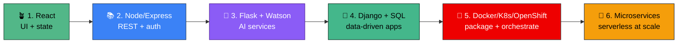
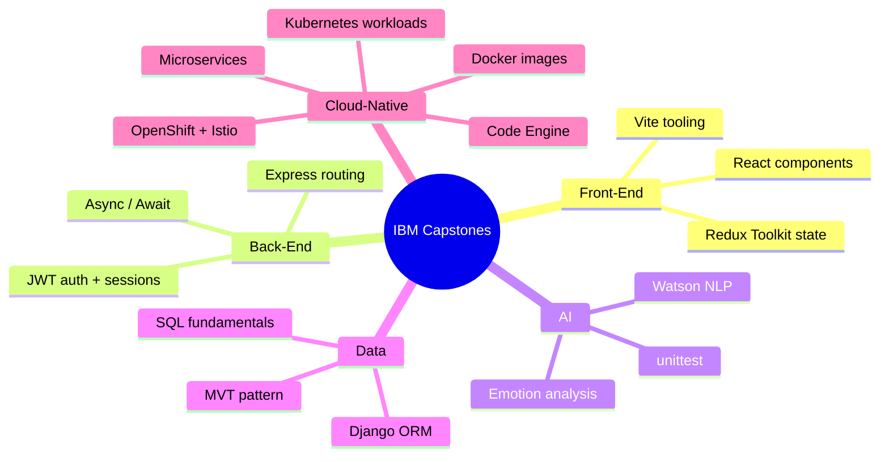
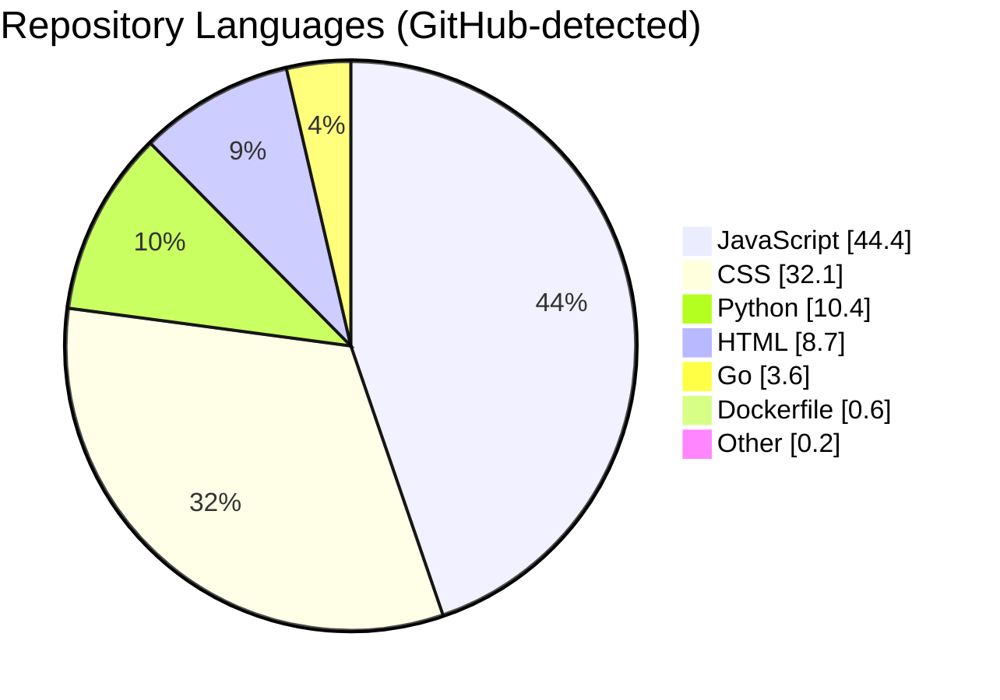
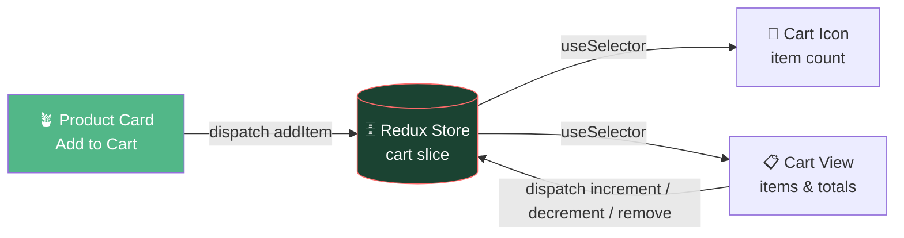
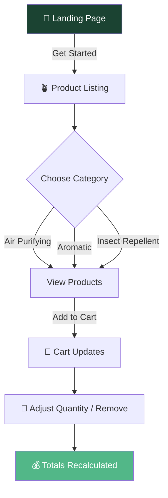
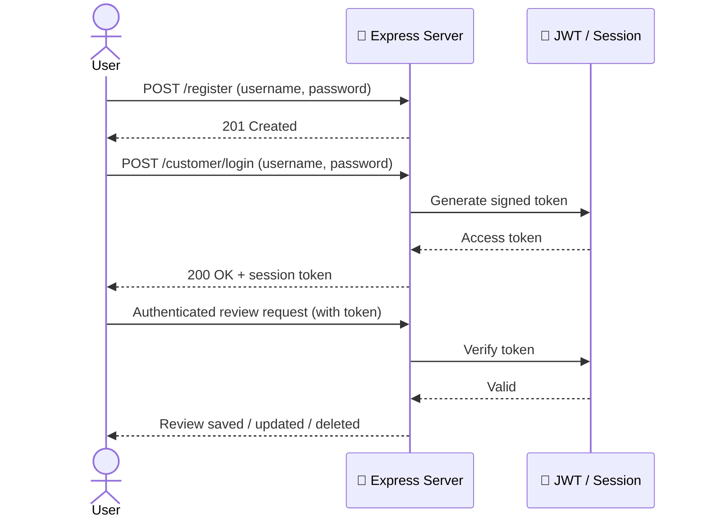
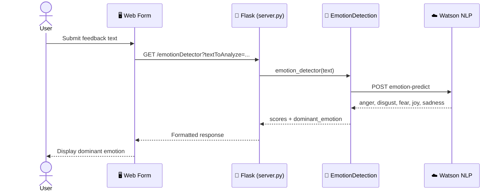
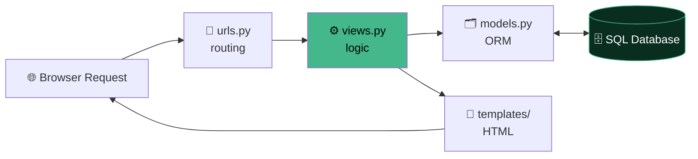
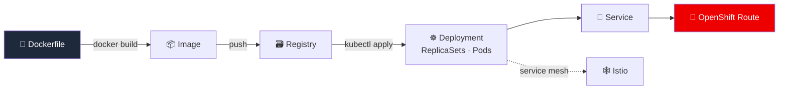
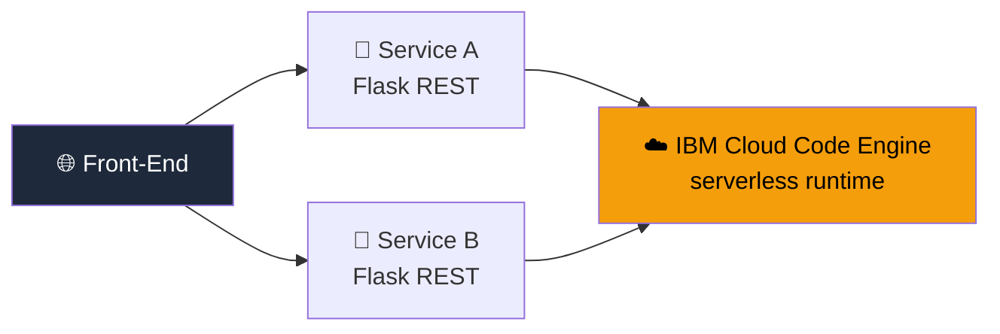

<a id="top"></a>
<div align="center">


<br/>


<br/><br/>


<br/><br/>

**[🚀 Projects](#projects) · [🗺️ Journey](#journey) · [📊 Stats](#stats) · [🗂️ Structure](#structure) · [⚡ Quick Start](#quickstart) · [👤 Author](#author)**

</div>

<br/>

> **FP-IBM-DFEAR** is a single repository holding the **final capstone project of six IBM certification courses** on Coursera. Together they cover the whole modern stack — a React/Redux storefront, a Node/Express REST API, a Watson-powered Flask AI app, a Django + SQL platform, a containerised Docker/Kubernetes/OpenShift pipeline, and a microservices + serverless system on IBM Cloud Code Engine.

---

<a id="overview"></a>
## 🧭 At a Glance

| # | Project | Layer | Core Tech | Course |
|:-:|---|:-:|---|:-:|
| 1 | [🪴 Paradise Nursery](#p1) | Front-End | React · Redux Toolkit · Vite · CSS | [](https://www.coursera.org/learn/developing-frontend-apps-with-react/home/welcome) |
| 2 | [📚 Express Book Review](#p2) | Back-End | Node.js · Express · JWT · Axios | [](https://www.coursera.org/learn/developing-backend-apps-with-nodejs-and-express) |
| 3 | [🤖 AI Emotion Detector](#p3) | AI / Web | Python · Flask · Watson NLP | [](https://www.coursera.org/learn/python-project-for-ai-application-development) |
| 4 | [🐍 Django Course App](#p4) | Full-Stack | Django · SQL · Bootstrap | [](https://www.coursera.org/learn/developing-applications-with-sql-databases-and-django) |
| 5 | [🐳 Containers & Orchestration](#p5) | DevOps | Docker · Kubernetes · OpenShift · Istio | [](https://www.coursera.org/learn/ibm-containers-docker-kubernetes-openshift) |
| 6 | [🧩 Microservices & Serverless](#p6) | Cloud | Flask · Docker · IBM Cloud Code Engine | [](https://www.coursera.org/learn/applications-development-microservices-serverless-openshift) |

---

<a id="journey"></a>
## 🗺️ The Learning Journey

How the six projects stack up into one full-stack skill set:



### 🧠 Skills Map



### 🧰 Technology Coverage

| Area | Technologies | Projects |
|---|---|:-:|
| **Languages** | JavaScript, Python, HTML, CSS | 1 · 2 · 3 · 4 · 6 |
| **Front-End** | React, Redux Toolkit, Vite, Bootstrap | 1 · 4 |
| **Back-End** | Node.js, Express, Flask, Django | 2 · 3 · 4 · 6 |
| **Auth** | JWT, Express Session, Django Auth | 2 · 4 |
| **AI / NLP** | IBM Watson NLP | 3 |
| **Databases** | SQL, Django ORM | 4 |
| **DevOps** | Docker, Kubernetes, OpenShift, Istio | 5 · 6 |
| **Cloud** | IBM Cloud Code Engine | 6 |
| **Testing & Tools** | unittest, Postman, cURL, Git | 2 · 3 |

---

<a id="stats"></a>
## 📊 Language Breakdown



| Language | Share | Visual | Mostly found in |
|:---:|:---:|---|---|
| 🟨 [JavaScript](https://github.com/Talha-Yaseen-Hub/FP-IBM-DFEAR/search?l=javascript) | **44.4%** | `████████░░` | React app, Express API |
| 🟦 [CSS](https://github.com/Talha-Yaseen-Hub/FP-IBM-DFEAR/search?l=css) | **32.1%** | `██████░░░░` | Paradise Nursery, Bootstrap templates |
| 🐍 [Python](https://github.com/Talha-Yaseen-Hub/FP-IBM-DFEAR/search?l=python) | **10.4%** | `██░░░░░░░░` | Django app, Flask AI app, microservices |
| 🟧 [HTML](https://github.com/Talha-Yaseen-Hub/FP-IBM-DFEAR/search?l=html) | **8.7%** | `█░░░░░░░░░` | Django & Flask templates |
| 🔵 [Go](https://github.com/Talha-Yaseen-Hub/FP-IBM-DFEAR/search?l=go) | **3.6%** | `░░░░░░░░░░` | Sample service in the containers project ¹ |
| 🐳 [Dockerfile](https://github.com/Talha-Yaseen-Hub/FP-IBM-DFEAR/search?l=dockerfile) | **0.6%** | `░░░░░░░░░░` | Container image definitions |
| ⚪ [Other](https://github.com/Talha-Yaseen-Hub/FP-IBM-DFEAR/search?l=Other) | **0.2%** | `░░░░░░░░░░` | Config & misc files |

<sub>¹ Go's location is inferred from the language split, not verified file-by-file.</sub>

---

<a id="projects"></a>
# 🚀 Projects

<a id="p1"></a>
## 🪴 1 · Paradise Nursery
**`React` `Redux Toolkit` `Vite` `CSS3`** — [📘 IBM Course](https://www.coursera.org/learn/developing-frontend-apps-with-react/home/welcome)

An online plant shop: browse categorised houseplants, add them to a live cart, and manage quantities with instantly recalculated totals.

<!-- Add a demo:  -->
> 📸 *Demo GIF / screenshot goes here — see [Adding Visuals](#visuals).*

| | Feature | Description |
|:-:|---|---|
| 🌿 | **Landing Page** | Company intro, short background, and a "Get Started" button |
| 🪴 | **Product Listing** | Houseplants grouped by category with image, name, description and price |
| 🛒 | **Shopping Cart** | Live cart icon showing total item count |
| 🔧 | **Cart Management** | Increase/decrease quantity, remove items, auto-recalculated totals |

<div align="center">


</div>

<details>
<summary><b>🔄 Redux data flow &amp; user flow</b></summary>





</details>

```bash
npm install      # install dependencies (from the project root)
npm run dev      # start Vite dev server, then open the printed localhost URL
```

<div align="right"><a href="#top">⬆ back to top</a></div>

---

<a id="p2"></a>
## 📚 2 · Express Book Review
**`Node.js` `Express` `JWT` `Axios`** — [📘 IBM Course](https://www.coursera.org/learn/developing-backend-apps-with-nodejs-and-express)

A server-side bookstore API: search books, manage reviews, and authenticate users securely — using Promises and Async/Await via Axios.

> 📸 *Postman screenshot / GIF goes here — see [Adding Visuals](#visuals).*

| | Feature | Description |
|:-:|---|---|
| 📚 | **Book Retrieval** | List all books or search by ISBN, author, or title |
| 💬 | **Review Management** | View reviews; authenticated users add, modify, or delete their own |
| 🔐 | **Authentication** | Register / log in with JWT and session management |
| ⚡ | **Async Operations** | Promises and Async/Await via Axios |

<details>
<summary><b>🔐 Auth flow &amp; API route map</b></summary>



> ⚠️ *Standard route structure for this IBM capstone — verify against your `router/` files before relying on exact paths.*

| Method | Endpoint | Auth | Purpose |
|:-:|---|:-:|---|
| `GET` | `/` | ❌ | List all books |
| `GET` | `/isbn/:isbn` | ❌ | Find book by ISBN |
| `GET` | `/author/:author` | ❌ | Find books by author |
| `GET` | `/title/:title` | ❌ | Find books by title |
| `GET` | `/review/:isbn` | ❌ | Read a book's reviews |
| `POST` | `/register` | ❌ | Create an account |
| `POST` | `/customer/login` | ❌ | Log in, receive token |
| `PUT` | `/customer/auth/review/:isbn` | 🔒 | Add / modify your review |
| `DELETE` | `/customer/auth/review/:isbn` | 🔒 | Delete your review |

</details>

```bash
cd expressBookReview
npm install
npm start        # serves on port 5000 — test with Postman or cURL
```

<div align="right"><a href="#top">⬆ back to top</a></div>

---

<a id="p3"></a>
## 🤖 3 · AI Emotion Detector
**`Python` `Flask` `IBM Watson NLP` `unittest`** — [📘 IBM Course](https://www.coursera.org/learn/python-project-for-ai-application-development)

A web app that takes customer feedback and runs it through Watson NLP to detect *which* emotion is behind it, not just positive vs. negative — then surfaces the dominant one.

> 📸 *Emotion detector screenshot / GIF goes here — see [Adding Visuals](#visuals).*

| | Feature | Description |
|:-:|---|---|
| 💬 | **Text Input** | Free-form feedback via a simple web form |
| 🧠 | **Emotion Analysis** | Watson NLP emotion-prediction model |
| 📊 | **Five-Emotion Breakdown** | Scores for anger, disgust, fear, joy, sadness |
| 🏆 | **Dominant Emotion** | Highest-scoring emotion as the headline result |
| ⚠️ | **Input Validation** | Blank submissions are flagged before reaching the model |
| ✅ | **Unit Tests** | `test_emotion_detection.py` via `unittest` |

> ⚠️ *Emotion schema reflects Watson's standard `EmotionPredict` output — confirm against your `EmotionDetection/` module.*

<details>
<summary><b>🔄 Emotion detection flow</b></summary>



</details>

```bash
cd final_project_emotion_detection
pip install -r requirements.txt
python server.py   # port 5000 (or next available)
```

<div align="right"><a href="#top">⬆ back to top</a></div>

---

<a id="p4"></a>
## 🐍 4 · Django Course App
**`Django` `Python` `SQL` `Bootstrap`** — [📘 IBM Course](https://www.coursera.org/learn/developing-applications-with-sql-databases-and-django)

A full-stack online course platform. The final project extends a base course app with a new assessment feature, built on SQL fundamentals, the Django ORM, the MVT pattern, authentication and cloud deployment.

> 📸 *Course app screenshot / GIF goes here — see [Adding Visuals](#visuals).*

| | Feature | Description |
|:-:|---|---|
| 📚 | **Course Catalog** | Courses with details and instructors |
| 📝 | **Enrollment** | Registered users can enroll |
| ✅ | **Assessments** *(final project)* | New exam/quiz feature on the base app |
| 🔐 | **Authentication** | Login, logout, registration, permissions, groups |
| 🛠️ | **Admin Site** | Configured with search and filters |
| 🎨 | **Styling** | Bootstrap-based templates and static assets |

> ⚠️ *Exact assessment requirements come from the course rubric — this table shows the general shape, not a verified list of your implementation.*

<details>
<summary><b>🔄 Django MVT flow</b></summary>



</details>

```bash
cd <django-project-folder>      # replace with the real folder name
pip install -r requirements.txt
python manage.py migrate
python manage.py runserver
```

<div align="right"><a href="#top">⬆ back to top</a></div>

---

<a id="p5"></a>
## 🐳 5 · Containers with Docker, Kubernetes & OpenShift
**`Docker` `Kubernetes` `OpenShift` `Istio`** — [📘 IBM Course](https://www.coursera.org/learn/ibm-containers-docker-kubernetes-openshift)

Containerise an app, orchestrate it with Kubernetes, then explore OpenShift and Istio. The final project builds and deploys a simple health-check application through the full pipeline.

> 📸 *Deployed app / dashboard screenshot goes here — see [Adding Visuals](#visuals).*

| | Stage | What it covers |
|:-:|---|---|
| 📦 | **Containerization** | Build a Docker image, run it as a container |
| ☸️ | **Kubernetes Basics** | Core objects, architecture, `kubectl` |
| 🔁 | **Managing Workloads** | ReplicaSets, autoscaling, rolling updates, ConfigMaps & Secrets |
| 🔴 | **OpenShift** | Builds, Operators, Red Hat OpenShift on Kubernetes |
| 🕸️ | **Service Mesh** | Introductory Istio |
| 🩺 | **Final Project** | Build & deploy a health-check app end-to-end |

<details>
<summary><b>🔄 Container deployment flow</b></summary>



</details>

```bash
docker build -t <image-name> .
docker run -p 8080:8080 <image-name>

kubectl apply -f deployment.yaml
kubectl get pods
```

<sub>Image names and manifest filenames are placeholders — use your project's actual ones.</sub>

<div align="right"><a href="#top">⬆ back to top</a></div>

---

<a id="p6"></a>
## 🧩 6 · Microservices & Serverless
**`Python` `Flask` `Docker` `IBM Cloud Code Engine`** — [📘 IBM Course](https://www.coursera.org/learn/applications-development-microservices-serverless-openshift)

A front-end backed by several small, independently deployable Flask REST APIs instead of a monolith, shipped serverlessly on IBM Cloud Code Engine.

> 📸 *Running application screenshot / GIF goes here — see [Adding Visuals](#visuals).*

| | Feature | Description |
|:-:|---|---|
| 🧩 | **Microservice APIs** | Independent Flask services, one responsibility each |
| 🌐 | **Front-End** | Client app consuming the services |
| ☁️ | **Serverless Deployment** | IBM Cloud Code Engine, no server management |
| 📈 | **Independent Scaling** | Each service scales on its own |

<details>
<summary><b>🔄 Architecture flow &amp; monolith vs. microservices</b></summary>



| | Monolith | Microservices (this project) |
|---|:-:|:-:|
| Deployment | All-or-nothing | Per service |
| Scaling | Whole app | Per service |
| Failure blast radius | Large | Contained |
| Tech flexibility | Limited | High |

</details>

```bash
cd <microservice-folder>
pip install -r requirements.txt
flask run
```

<sub>Code Engine deployment is account-specific — follow the `ibmcloud ce` CLI steps for your own account.</sub>

<div align="right"><a href="#top">⬆ back to top</a></div>

---

<a id="structure"></a>
## 🗂️ Repository Structure

> ⚠️ *Only `expressBookReview/` and `final_project_emotion_detection/` are named in the original README. The other folder names are placeholders — rename them to match the repo.*

```text
FP-IBM-DFEAR/
├── 📁 paradise-nursery/               # 1 · React + Redux Toolkit + Vite
├── 📁 expressBookReview/              # 2 · Node.js + Express + JWT
├── 📁 final_project_emotion_detection/# 3 · Flask + Watson NLP
├── 📁 django-course-app/              # 4 · Django + SQL
├── 📁 containers-k8s-openshift/       # 5 · Docker / Kubernetes / OpenShift
├── 📁 microservices-serverless/       # 6 · Flask microservices + Code Engine
├── 📁 docs/
│   └── 📁 screenshots/                # GIFs & images used in this README
└── 📄 README.md
```

---

<a id="quickstart"></a>
## ⚡ Quick Start

```bash
# Clone the repo
git clone https://github.com/Talha-Yaseen-Hub/FP-IBM-DFEAR.git
cd FP-IBM-DFEAR
```

| Project | Prerequisites | Run |
|---|---|---|
| 1 · React | Node.js 18+ | `npm install && npm run dev` |
| 2 · Express | Node.js | `npm install && npm start` (port 5000) |
| 3 · Flask AI | Python 3.8+ | `pip install -r requirements.txt && python server.py` |
| 4 · Django | Python 3.8+ | `pip install -r requirements.txt && python manage.py migrate && python manage.py runserver` |
| 5 · Containers | Docker, `kubectl`, cluster access | `docker build` → `kubectl apply -f` |
| 6 · Microservices | Python, Docker, IBM Cloud account | `flask run` locally; `ibmcloud ce` to deploy |

---

<a id="visuals"></a>
## 🎞️ Adding Visuals (Screenshots & GIFs)

1. Record each project with [ScreenToGif](https://www.screentogif.com/), [LICEcap](https://www.cockos.com/licecap/), or Peek.
2. Save to `docs/screenshots/` (keep each GIF under ~5 MB).
3. Replace the 📸 placeholder in each project with:

```markdown

```

**Suggested shots:** cart updating live (1) · Postman login + review (2) · emotion result (3) · assessment page (4) · `kubectl get pods` (5) · deployed Code Engine app (6).

---

<a id="author"></a>
## 👤 Author

<div align="center">

### Talha Yaseen
*Full-stack developer · IBM-certified learner*

<br/>

<a href="https://github.com/Talha-Yaseen-Hub/FP-IBM-DFEAR"></a>
<a href="https://github.com/Talha-Yaseen-Hub"></a>
<a href="https://www.linkedin.com/in/talha-yaseen-44a41a341/"></a>
<a href="mailto:talhavectorarts@gmail.com"></a>

<br/><br/>

⭐ **If this repo helped you, consider giving it a star!** ⭐

[⬆ Back to Top](#top)


</div>
