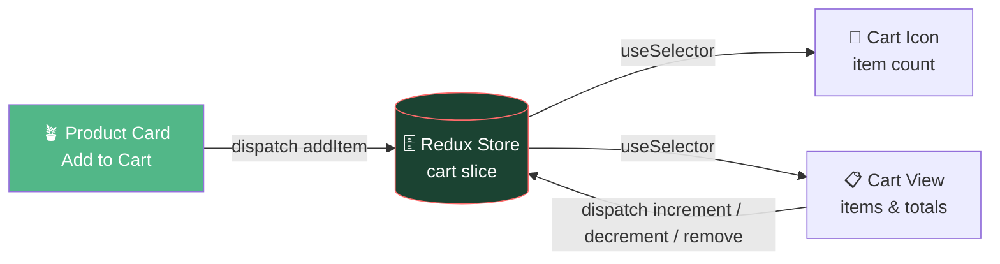
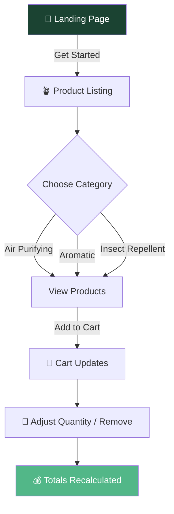
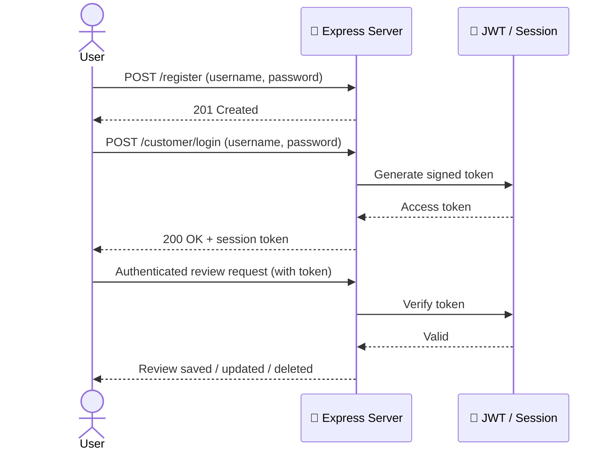
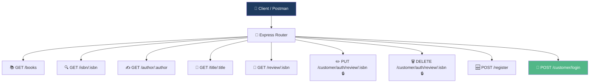
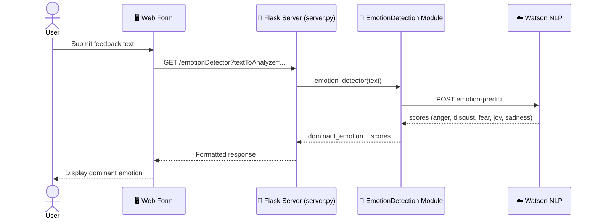
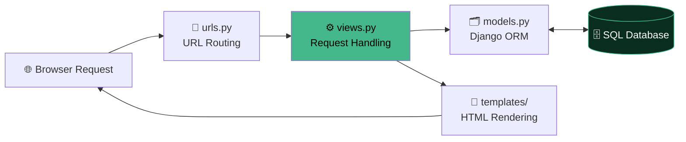
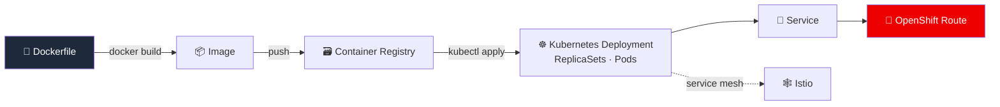
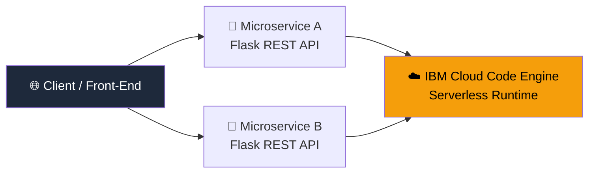

<a name="top"></a>
<div align="center">


<br/>


<br/><br/>


<br/><br/>

<a href="https://www.coursera.org/learn/developing-frontend-apps-with-react/home/welcome">

</a>
<a href="https://www.coursera.org/learn/developing-backend-apps-with-nodejs-and-express">

</a>
<a href="https://www.coursera.org/learn/python-project-for-ai-application-development">

</a>
<br/>
<a href="https://www.coursera.org/learn/developing-applications-with-sql-databases-and-django">

</a>
<a href="https://www.coursera.org/learn/ibm-containers-docker-kubernetes-openshift">

</a>
<a href="https://www.coursera.org/learn/applications-development-microservices-serverless-openshift">

</a>

<br/><br/>


</div>

<br/><br/>

> This repository holds **six final capstone projects** completed for IBM certifications on Coursera — spanning a React/Redux front-end, a Node/Express back-end, a Python/Flask AI application powered by Watson NLP, a Django app backed by SQL, a Docker/Kubernetes/OpenShift container pipeline, and a microservices + serverless architecture on IBM Cloud Code Engine.

<br/>

## 📊 Languages

| Language | Share | Primarily Used In |
|:---:|:---:|---|
| 🟨 JavaScript | **44.4%** | Paradise Nursery (React/Redux), Express Book Review (Node/Express) |
| 🟦 CSS | **32.1%** | Paradise Nursery styling, Bootstrap-based templates |
| 🐍 Python | **10.4%** | Django Course App, Build & Deploy AI Application (Flask) |
| 🟧 HTML | **8.7%** | Django templates, Flask templates |
| 🔵 Go | **3.6%** | A sample service in the containers project *(inferred from the language split — not verified file-by-file)* |
| 🐳 Dockerfile | **0.6%** | Image definitions for the containers project |
| ⚪ Other | **0.2%** | Config and misc files |

<br>

---

## 📖 Table of Contents

<details open>
<summary><b>▼ Click to expand / collapse</b></summary>

<br/>

<table>
<tr>
<td valign="top" width="50%">

**🪴 Paradise Nursery**
- [Features](#paradise-nursery-features)
- [Product Categories](#product-categories)
- [Redux Data Flow](#redux-data-flow)
- [User Flow](#user-flow)
- [Tech Stack](#paradise-nursery-tech-stack)
- [Getting Started](#paradise-nursery-getting-started)

</td>
<td valign="top" width="50%">

**📚 Express Book Review**
- [Features](#express-book-review-features)
- [Auth Flow](#auth-flow)
- [API Route Map](#api-route-map)
- [Tech Stack](#express-book-review-tech-stack)
- [Getting Started](#express-book-review-getting-started)

</td>
</tr>
<tr>
<td valign="top" width="50%">

**🤖 Build and Deploy AI Application**
- [Features](#ai-application-features)
- [Emotion Detection Flow](#emotion-detection-flow)
- [Tech Stack](#ai-application-tech-stack)
- [Getting Started](#ai-application-getting-started)

</td>
<td valign="top" width="50%">

**🐍 Django Course App**
- [Features](#django-app-features)
- [Django MVT Flow](#django-mvt-flow)
- [Tech Stack](#django-app-tech-stack)
- [Getting Started](#django-app-getting-started)

</td>
</tr>
<tr>
<td valign="top" width="50%">

**🐳 Containers with Docker, Kubernetes & OpenShift**
- [Features](#containers-project-features)
- [Container Deployment Flow](#container-deployment-flow)
- [Tech Stack](#containers-tech-stack)
- [Getting Started](#containers-getting-started)

</td>
<td valign="top" width="50%">

**🧩 Microservices and Serverless**
- [Features](#microservices-features)
- [Architecture Flow](#microservices-architecture-flow)
- [Tech Stack](#microservices-tech-stack)
- [Getting Started](#microservices-getting-started)

</td>
</tr>
</table>

[📊 Languages](#-languages) · [👤 Author](#-author)

</details>

<br/>

---

<br/>

# 🪴 Paradise Nursery
**React.js & Redux Toolkit**

A beautiful, functional shopping cart application for an online plant shop — browse categorized houseplants, add them to a live cart, and manage quantities with instantly recalculated totals.

<br/>

*📸 Drop a screenshot or GIF of the shopping cart here.*

<br/>

### Paradise Nursery Features

| | Feature | Description |
|:---:|---|---|
| 🌿 | **Landing Page** | Welcoming intro featuring the company name, a brief background, and a "Get Started" button |
| 🪴 | **Product Listing** | Browse houseplants organized by category, each with an image, name, description, and price |
| 🛒 | **Shopping Cart** | Add products to your cart — the cart icon updates live to reflect total item count |
| 🔧 | **Cart Management** | Increase/decrease quantities, remove items, and see totals recalculate automatically |

<br/>

### Product Categories

<div align="center">


</div>

<br/>

### Redux Data Flow

*How adding an item to the cart propagates through the app:*



<br/>

### User Flow



<br/>

### Paradise Nursery Tech Stack

<div align="center">


</div>

<br/>

| Technology | Purpose |
|---|---|
| **React.js** | UI component library |
| **Redux Toolkit** | Centralized cart state management |
| **Vite** | Fast dev server and build tooling |
| **CSS3** | Styling |

<br/>

### Paradise Nursery Getting Started

```bash
# 1. Install dependencies (from the project root)
npm install

# 2. Start the development server
npm run dev

# 3. Open your browser to the localhost port shown in the terminal
```

<br/>

---

<br/>

# 📚 Express Book Review
**Node.js & Express.js**

A server-side application for an online bookstore — book search, review management, and secure user authentication, built with asynchronous operations via Promises and Async/Await.

<br/>

*📸 Drop a screenshot or GIF of the book review API in action (e.g. Postman) here.*

<br/>

### Express Book Review Features

| | Feature | Description |
|:---:|---|---|
| 📚 | **Book Retrieval** | List all available books, or search by ISBN, author name, or title |
| 💬 | **Review Management** | View reviews for a book; authenticated users can add, modify, or delete their own reviews |
| 🔐 | **User Authentication** | Register and log in securely using JSON Web Tokens (JWT) and session management |
| ⚡ | **Asynchronous Operations** | Uses Promises and Async/Await via Axios to interact with data efficiently |

<br/>

### Auth Flow



<br/>

### API Route Map

> ⚠️ *This reflects the standard route structure typical of this specific IBM capstone — verify it against your actual `router/` implementation before relying on exact paths.*



<br/>

### Express Book Review Tech Stack

<div align="center">


</div>

<br/>

| Technology | Purpose |
|---|---|
| **Node.js** | JavaScript runtime |
| **Express.js** | Web application / routing framework |
| **JSON Web Tokens (JWT) & Express Session** | Authentication and session management |
| **Axios** | Async/Await-based HTTP interactions |

<br/>

### Express Book Review Getting Started

```bash
# 1. Navigate to the backend directory
cd expressBookReview

# 2. Install dependencies
npm install

# 3. Start the server
npm start
```

Server runs on **port `5000`** — test endpoints via Postman or cURL.

<br/>

---

<br/>

# 🤖 Build and Deploy AI Application
**Python, Flask & IBM Watson NLP**

Built for IBM's *Developing AI Applications with Python and Flask* capstone — a web app that takes customer feedback text and runs it through the Watson NLP library to detect the emotions behind it (not just positive/negative sentiment, but *which* emotion), then surfaces the dominant one.

<br/>

*📸 Drop a screenshot or GIF of the emotion detector in action here.*

<br/>

### AI Application Features

| | Feature | Description |
|:---:|---|---|
| 💬 | **Text Input** | Accepts free-form customer feedback text through a simple web form |
| 🧠 | **Emotion Analysis** | Runs the text through Watson NLP's emotion-prediction model |
| 📊 | **Five-Emotion Breakdown** | Returns scores for anger, disgust, fear, joy, and sadness |
| 🏆 | **Dominant Emotion** | Surfaces the single highest-scoring emotion as the headline result |
| ⚠️ | **Input Validation** | Flags blank submissions before they reach the model |

> ⚠️ *The emotion schema above reflects Watson NLP's standard `EmotionPredict` output for this specific IBM capstone — confirm it matches your `EmotionDetection/` module before relying on it.*

<br/>

### Emotion Detection Flow



<br/>

### AI Application Tech Stack

<div align="center">


</div>

<br/>

| Technology | Purpose |
|---|---|
| **Python** | Core application language |
| **Flask** | Web server and routing |
| **IBM Watson NLP Library** | Emotion detection model |
| **unittest** | Automated tests (`test_emotion_detection.py`) |

<br/>

### AI Application Getting Started

```bash
# 1. Navigate to the project directory
cd final_project_emotion_detection

# 2. Install dependencies
pip install -r requirements.txt

# 3. Start the server
python server.py
```

Server runs on **port `5000`** (or the next available port) — open it in your browser.

<br/>

---

<br/>

# 🐍 Django Course App
**Python, Django & SQL**

Built for IBM's *Developing Applications with SQL, Databases, and Django* capstone — a full-stack online course platform. The final project extends a base course app with a new assessment feature, on top of a foundation covering SQL fundamentals, Django's ORM, the Model-View-Template pattern, authentication, and cloud deployment.

<br/>

*📸 Drop a screenshot or GIF of the course app here.*

<br/>

### Django App Features

| | Feature | Description |
|:---:|---|---|
| 📚 | **Course Catalog** | Lists available online courses with details and instructors |
| 📝 | **Enrollment** | Registered users can enroll in courses |
| ✅ | **Assessments** *(final project)* | Adds a new exam/quiz feature on top of the base course app |
| 🔐 | **Authentication** | Login, logout, registration, permissions, and groups via Django's built-in auth |
| 🛠️ | **Admin Site** | Django admin configured with search and filter for course data |
| 🎨 | **Styling** | Bootstrap-based templates and static assets |

> ⚠️ *The exact assessment requirements come from the course's grading rubric — this table reflects the base "Online Course App" plus the general shape of the final assignment, not a verified list of your specific implementation.*

<br/>

### Django MVT Flow



<br/>

### Django App Tech Stack

<div align="center">


</div>

<br/>

| Technology | Purpose |
|---|---|
| **Django** | Web framework (MVT pattern, ORM, admin site) |
| **Python** | Core application language |
| **SQL Database** | Relational data storage (PostgreSQL / SQLite depending on environment) |
| **Bootstrap** | Front-end styling |
| **Django Auth** | Login, registration, permissions, and groups |

<br/>

### Django App Getting Started

```bash
# 1. Navigate to the project directory
cd <django-project-folder>

# 2. Install dependencies
pip install -r requirements.txt

# 3. Apply migrations
python manage.py migrate

# 4. Start the development server
python manage.py runserver
```

*Replace `<django-project-folder>` with this project's actual folder name in the repo.*

<br/>

---

<br/>

# 🐳 Containers with Docker, Kubernetes & OpenShift
**Docker, Kubernetes, Red Hat OpenShift & Istio**

Hands-on work from IBM's *Introduction to Containers w/ Docker, Kubernetes & OpenShift* course — containerizing an application, orchestrating it with Kubernetes, and exploring the OpenShift and Istio ecosystem on top of it. The final project builds and deploys a simple health-check application through that full pipeline.

<br/>

*📸 Drop a screenshot or GIF of the deployed app / dashboard here.*

<br/>

### Containers Project Features

| | Stage | What It Covers |
|:---:|---|---|
| 📦 | **Containerization** | Building a Docker image and running it as a container |
| ☸️ | **Kubernetes Basics** | Core objects, architecture, and `kubectl` |
| 🔁 | **Managing Workloads** | ReplicaSets, autoscaling, rolling updates, ConfigMaps & Secrets |
| 🔴 | **OpenShift Ecosystem** | Builds, Operators, and Red Hat OpenShift on top of Kubernetes |
| 🕸️ | **Service Mesh** | Introductory look at Istio |
| 🩺 | **Final Project** | Build and deploy a simple health-check application end-to-end |

<br/>

### Container Deployment Flow



<br/>

### Containers Tech Stack

<div align="center">


</div>

<br/>

| Technology | Purpose |
|---|---|
| **Docker** | Building and running container images |
| **Kubernetes** | Container orchestration, scaling, and deployment |
| **Red Hat OpenShift** | Enterprise Kubernetes platform — builds, Operators, routes |
| **Istio** | Service mesh introduced alongside OpenShift |

<br/>

### Containers Getting Started

```bash
# Build and run the image locally
docker build -t <image-name> .
docker run -p 8080:8080 <image-name>

# Deploy to Kubernetes
kubectl apply -f deployment.yaml
kubectl get pods
```

*Filenames and image tags above are placeholders — swap in whatever this project's Dockerfile and manifests are actually named.*

<br/>

---

<br/>

# 🧩 Microservices and Serverless
**Python, Flask, Microservices & IBM Cloud Code Engine**

Built for IBM's *Application Development using Microservices and Serverless* capstone — a front-end backed by several small, independently deployable Flask REST APIs instead of one monolith, with the whole thing shipped serverlessly on IBM Cloud Code Engine.

<br/>

*📸 Drop a screenshot or GIF of the running application here.*

<br/>

### Microservices Features

| | Feature | Description |
|:---:|---|---|
| 🧩 | **Microservice APIs** | Multiple independent Flask REST services, each owning one responsibility |
| 🌐 | **Front-End** | Client application that consumes the microservices |
| ☁️ | **Serverless Deployment** | Runs on IBM Cloud Code Engine — no server management |
| 📈 | **Independent Scaling** | Each microservice scales on its own, separate from the others |

<br/>

### Microservices Architecture Flow



<br/>

### Microservices Tech Stack

<div align="center">


</div>

<br/>

| Technology | Purpose |
|---|---|
| **Python & Flask** | REST API framework for each microservice |
| **IBM Cloud Code Engine** | Serverless deployment platform |
| **Docker** | Packaging each microservice as a container image |

<br/>

### Microservices Getting Started

```bash
# 1. Navigate to a microservice directory
cd <microservice-folder>

# 2. Install dependencies
pip install -r requirements.txt

# 3. Run it locally
flask run
```

*Deploying to IBM Cloud Code Engine is environment-specific — follow the `ibmcloud ce` CLI steps for your own account rather than generic commands here.*

<br/>

---
<br/>

## 👤 Author

<div align="center">

### Talha Yaseen

<br/>

<a href="https://github.com/Talha-Yaseen-Hub/FP-IBM-DFEAR">
  
</a>
<a href="mailto:talhavectorarts@gmail.com">
  
</a>
<a href="https://www.linkedin.com/in/talha-yaseen-44a41a341">
  
</a>
<a href="https://github.com/Talha-Yaseen-Hub">
  
</a>

</div>

<br/><br/>

<div align="center">

[⬆ Back to Top](#top)

<br/><br/>


</div>
